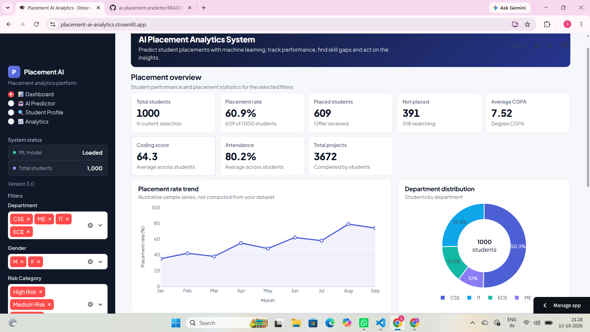

# 🎓 AI Placement Analytics System

**An intelligent career analytics platform that helps students understand their placement readiness, discover suitable job roles, analyze the quality of their projects, and receive personalized guidance to improve their chances of getting hired.**

**Unlike typical placement prediction projects that only output a "Placed / Not Placed" result, this system explains *why* a student is predicted as placed or not, *which* job roles best match their skills, *how* their projects measure up, and *what* they should improve next.**

🔗 **[Live Demo → placement-ai-analytics.streamlit.app](https://placement-ai-analytics.streamlit.app)**

---

## ❓ What Is This Project?

**AI Placement Analytics System** is a complete career preparation platform for engineering students. It combines four intelligent modules into one unified experience:

| Module | What It Does |
|--------|--------------|
| 🎯 **Placement Predictor** | Predicts the probability of a student being placed based on academics, coding, aptitude, internships, and projects |
| 💼 **Job Role Matcher** | Matches student skills to real-world job roles using the official ESCO taxonomy (EU skills database) |
| 📁 **Project Analyzer** | Evaluates a student's project description and rates its quality across 10 dimensions |
| 🚀 **Recommendation Engine** | Generates personalized, prioritized advice on what the student should improve next |

**The platform is fully explainable** — every prediction comes with a LIME explanation showing which factors contributed most.

---

## 🧠 What Skills Does This Project Show?

- **Machine Learning** — XGBoost, feature engineering, hyperparameter tuning, model evaluation
- **Natural Language Processing** — Sentence-Transformers, zero-shot classification, semantic search
- **Explainable AI** — LIME (local) + SHAP (global) for transparent predictions
- **Data Engineering** — ETL pipeline, SQLite normalization, automated EDA
- **Full-Stack Development** — Streamlit, Plotly, interactive multi-page UI
- **Deployment** — Cloud deployment, requirements management, environment handling

---

## 📸 Screenshot

**Dashboard — Live KPIs & Analytics**

---

## ✨ What's Inside This Project

### 🎯 Core Features

| Feature | Description |
|---------|-------------|
| **Placement Prediction** | XGBoost model with 91% accuracy and ROC-AUC 0.962 |
| **Job Role Matching** | Official ESCO taxonomy + sentence-transformers for skill-to-occupation mapping |
| **Project Quality Analyzer** | Zero-shot NLP across 10 dimensions (AI/ML, deployment, innovation) |
| **Recommendation Engine** | Rule-based engine with fuzzy skill matching and priority levels |
| **Explainable AI** | LIME (local) + SHAP (global) for every prediction |
| **Interactive Dashboard** | 4-page Streamlit app with multi-project support |

### 📊 Dashboard Pages

1. **📊 Dashboard** — KPIs, placement trends, department distribution, data explorer
2. **🤖 AI Predictor** — Full pipeline: predict, match jobs, analyze projects, get recommendations
3. **🔍 Student Profile** — Individual analysis with LIME and class comparison
4. **📈 Analytics** — Model metrics, confusion matrix, ROC curve, SHAP summary

### 🧠 AI & ML Components

- **XGBoost Classifier** — Trained on 1000+ student records with 8 engineered features
- **Sentence-Transformers** — `all-MiniLM-L6-v2` for 384-dim skill embeddings
- **Zero-Shot NLP** — `distilbert-base-uncased-mnli` for project classification
- **LIME & SHAP** — For model explainability and transparency

---

## 🛠️ Tech Stack

| Category | Technologies |
|----------|-------------|
| **Language** | Python 3.11 |
| **ML/AI** | XGBoost, Scikit-learn, Random Forest |
| **NLP** | Hugging Face Transformers, Sentence-Transformers |
| **Explainability** | LIME, SHAP |
| **Frontend** | Streamlit, Plotly |
| **Data** | Pandas, NumPy, SQLite |
| **Deployment** | Streamlit Cloud |

---

## 📊 Model Performance

| Metric | Value |
|--------|-------|
| **Accuracy** | 91.0% |
| **ROC-AUC** | 0.962 |
| **Precision** | 89.5% |
| **Recall** | 88.2% |

**Top Features:** overall_strength, experience_score, projects, academic_score

---

## 📂 Project Structure
├── app.py # Main Streamlit app (4 pages)

├── job_role_matcher.py # ESCO-based semantic matching

├── project_analyzer.py # Zero-shot NLP analyzer

├── recommendation_engine.py # Rule-based recommendations

├── model_training.py # XGBoost + RF training

├── feature_engineering.py # 8 engineered features

├── eda_analysis.py # EDA + T-tests

├── models/ # Trained .pkl models

├── esco/ # ESCO taxonomy CSVs

└── datadb/ # Dataset + SQLite database
